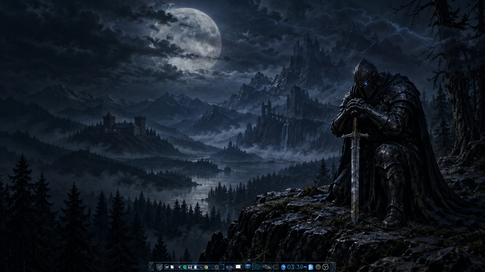

# BlackKnight theme/tutorial kit

Original BlackKnight Storm/Still wallpapers, blue-steel materials and a desktop reskin toolkit. See [v0.1.0 downloads](https://github.com/auzieman/BlackKnight-E-Theme/releases/tag/v0.1.0) and [release scope](docs/release-v0.1.0.md).



BlackKnight wallpaper and blue-steel shelf on the native Enlightenment desktop.

Read [brief](docs/brief.md), [feature map](docs/feature-map.md), [active task](docs/task.md), [shared design/ownership contract](docs/project-contract.md), [branching](docs/branching.md) and [remote toolchain](docs/toolchain.md).

```text
master/ — shared theme foundation
themes/<name>/ — one folder per theme
build/ — toolchain/build preparation
docs/images/ — screenshots and visual evidence
.agents/skills/ — project workflows
```

Work from development into feature/<topic>; merge accepted features back to development. Validated releases merge to main and receive annotated version tags. Source licensing and reused-asset notices must be established before distribution.

First wallpaper pass: [BlackKnight MVP](themes/blackknight/README.md), [still artwork](themes/blackknight/assets/scene.png), and [source study/tutorial notes](docs/wallpaper-mvp.md). Animated EDJs compile through the lab-edge Swarm pipeline; native preview and protected desktop test evidence are in [local setup testing](docs/setup-test.md).

Deep reference study: [Sci-Fi and Transient-Color mechanisms](docs/theme-mechanisms.md), including active state chains, dormant filters and artwork adaptation boundaries.

Second material pass: [forged-blue chrome study](docs/blue-steel-pass.md), with focused/inactive and shelf concepts.

Current implementation slice: [raster artwork and native Edje assembly](master/blue-steel/README.md). Previous SVG chrome overlay is retired.

[Native compile/runtime evidence](docs/native-skin-test.md): lab-edge Swarm build and laptop test app.

[Desktop integration workflow and upstream references](docs/edje-desktop-workflow.md); project skill: [e-desktop-theme](.agents/skills/e-desktop-theme/SKILL.md).

[Final local theme and production wallpaper build](docs/final-build.md), including package paths and checksums.

Source and donor-distribution notices: [NOTICE.md](NOTICE.md).

Original code: **GPLv3**. Original artwork: **CC BY-SA 4.0**.
See [licensing scope and exceptions](LICENSING.md).

## AlpinE desktop and companion projects

- [AlpinEifyd](https://github.com/auzieman/AlpinEifyd): Alpine-native Enlightenment workstation and installer sources.
- [AlpinE’ifyd walkthrough](https://youtu.be/JF7gO9Wty5I): discussion and desktop tour.
- [AUZiX / AlpinE public home](https://auzix.auzietek.com/alpine/): release status and signed packages.
- [E-Jamz](https://github.com/auzieman/E-Jamz): companion project.

## AlpinE APK installation

Native packages are available through the signed AlpinE companion feed.
See [installation and public-key verification](https://github.com/auzieman/AlpinEifyd/blob/main/docs/companion-apks.md)
for AlpinE 3.24 x86_64. Packages preserve user settings and desktop selections.
