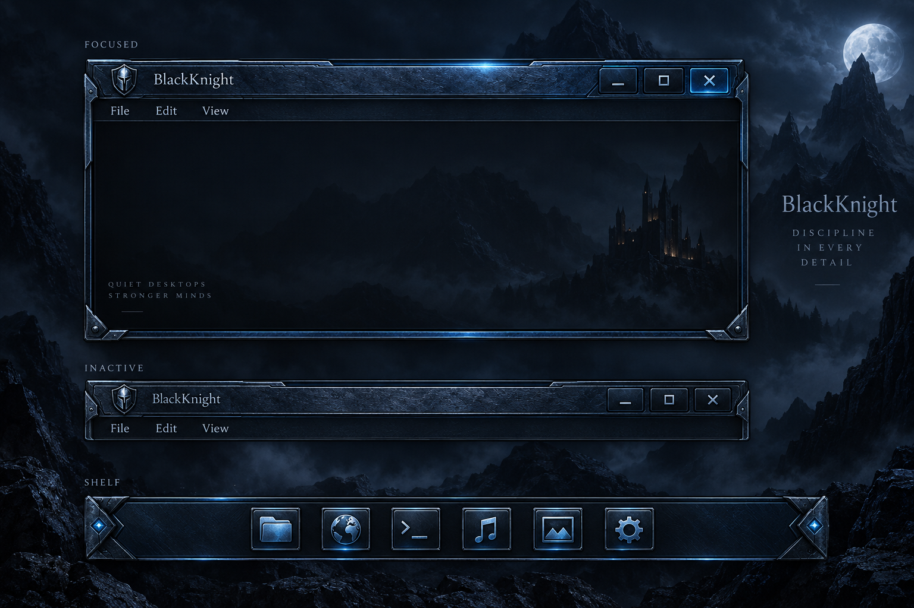

# BlackKnight forged-blue second pass

BK-006: original material concept, not an applied or compiled theme.

The generated sheet includes incidental slogans/background decoration; those are not proposed product copy or a replacement for the accepted wallpaper.

The first SVG remains a palette sketch. This pass explores a richer material: cobalt-blue steel, dark recessed joints, polished cut bevels, fine grain and small ice-blue emissive seams. Text and content remain visually quiet. Decoration belongs to chrome and corners rather than competing with controls.

## Translate the concept into existing E parts

| Layer | Role | Behaviour to preserve |
| --- | --- | --- |
| Base metal | Blue steel body, bevel and texture | Existing dimensions, alpha and scalable image borders |
| Recess/shadow | Dark seams and separation | Existing title/shadow focus states |
| Glint | Transparent highlight overlay | Existing clipping and focus program targets |
| Emissive edge | Small ice-blue accents | Active/hover emphasis, dim inactive state |
| Controls | Readable minimize/maximize/close | Existing hit regions, pressed state and action signals |
| Shelf | Matching orientation-aware metal | Existing fill/origin and vertical variants |

The concept sheet illustrates material and states, not an exact replacement geometry. Asset production must use measured dimensions from the selected editable theme; no E part should be renamed or rearranged to fit the mockup.

Wallpaper direction stays the accepted knight/castle scene. Oh-v1's different-speed tiled texture origins are a useful next cloud technique; tileable transparent textures must be authored and the reset visually verified before changing the current storm loop. The strike should remain synchronized to moon cover, followed by recovery to the same starting state.

Acceptance still needs a target render: compact/wide titlebars, rapid focus/hover changes, legibility, shelf orientation and idle cost. No continuous chrome animation is added by this concept. Remote compilation and licensing of any adapted upstream base remain pending.

Implementation direction is now [raster material with native Edje parts](../master/blue-steel/README.md). The SVG-derived asset set is retired; these source demonstrations still need native rendering before visual acceptance.

## Image remapping review — 2026-10-10

Compared the original Sci-Fi PNGs visually with `plate.png`, `button.png` and `glint.png`, and traced their actual bindings in `edc/border.edc`. This is a reskin of existing parts. The earlier whole-plate binding to `top_titlebar` is unsuitable: it introduces another pair of caps inside the existing caps and squeezes a large panel into a narrow strip.

| Existing image slot | Source size | Corresponding supplied material | Mapping requirement |
| --- | --- | --- | --- |
| `default_top_left_corner.png` | 30 × 27 | Plate's left bevel/cap | Fit the existing asymmetric silhouette and alpha; no extra frame inside it |
| `default_top_titlebar.png` | 49 × 27 | Plate's central steel and horizontal blue seams | Supply a cap-free strip; preserve existing stretching between corners |
| `default_top_right_corner.png` | 104 × 27 | Plate's right bevel/cap | Preserve space underneath the existing controls; this cap is much wider than the left |
| `default_left_border_mid.png`, `default_left_border_top.png`, `default_right_border.png` | 19 × 19 each | Plate/button side metal and blue edge | Preserve existing fill/tile rules; author coherent joins rather than shrinking the entire panel |
| `default_bottom_left_corner.png`, `default_bottom_right_corner.png` | 63 × 18 each | Lower bevel/corner material | Preserve existing corner silhouette and transparency |
| `default_bottom_left.png`, `default_bottom_right.png` | 31 × 16 each | Lower rail material | Join caps to the center without duplicate end ornaments |
| `default_bottom_mid.png` | 78 × 16 | Lower central blue rail | Preserve existing middle-strip geometry |
| `e17_mini_button.png` | 24 × 24 | Button's bevel/recess material | Produce a compact background; retain separate original action glyphs and event regions |
| `e17_titlebar_glint1.png`, `e17_titlebar_glint2.png`, `e17_titlebar_glint3.png` | 34 × 13, 169 × 18, 34 × 13 | Supplied glint's light vocabulary | Existing glints are separate shapes with their own border and state contracts; retain originals for the first pass |

The similarities are useful: both have angular end treatments, dark inset surfaces, blue horizontal seams and separate light effects. The supplied PNGs are material sources, not yet geometry-matched replacements. Their large ornaments and texture need deliberate treatment at the existing compact display sizes. Simply scaling the full plate or square button loses detail and repeats decoration.

Preserve `e.text.title`, `e.swallow.icon`, `e.swallow.client`, action glyphs, resize/event parts, shadows and focus/glint programs. `title_bar` is transparent in its existing descriptions; the visible base strip is `top_titlebar`. Existing glints use small separate images, including a 5-pixel image border, and active-state color modulation (for example 0/111/222). Those colors affect any replacement artwork, so an asset-only pass should first retain the effects and inspect the resulting tint.

First implementation should replace the existing frame image assets in an isolated copy, preserving filenames and EDC contracts. Confirm the unchanged original build first. Shelf and menu assets need their own measured mapping before extension; they have not been accepted by this frame review. No new desktop structure or animation is required by this pass.

The image-only desktop pass now runs: [native desktop evidence](native-skin-test.md) records the frame and shelf trials. Source-resolution refinement is permitted for the stretching center strip: v2 uses a 1024 × 27 strip while retaining donor EDC geometry. Fixed caps/tiles keep their original dimensions. The compiled donor's non-image entries remain byte-identical.

## Right-cap proportions — 2026-10-11

The previous recipe stretched the full right bevel across the 104-pixel control backing, while the left bevel used 30 pixels. The corrected recipe retains the right slot dimensions and donor alpha, using 74 pixels of center rail plus a 30-pixel right bevel. The separate `BlackKnight-BlueSteel-right-cap` candidate preserves all donor EDC and controls; native visual acceptance remains pending. [Enlarged cap inspection](images/right-cap-proportions-20261011.png).
