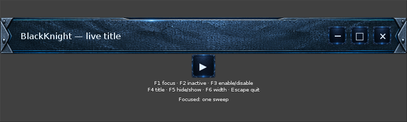
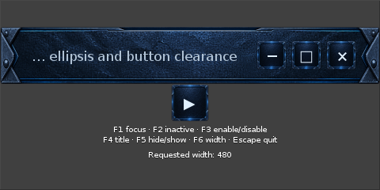

# Native skin compile and runtime test — 2026-10-10

Compiled EDJ and minimal EFL app successfully in lab-edge Swarm through BKC CLI/core, run `16a7df81-61d3-4da4-8fae-2983fe0c899a`, source `f1fd16d`. One CPU, 1 GiB limit, pinned Alpine 3.24.2 and signed EFL 1.28.1-r2 matching the laptop. The first run exposed C-dialect and callback-signature mistakes; both were corrected before the successful retry. The temporary compiler service was removed and existing services were untouched.

The test app runs on the laptop's existing EFL libraries; software_x11 was requested. Native focus reversal, live title changes, disabled/enabled clicks and hide/show were exercised using keys and window-targeted XTest input. Disabled click produced no action; enabled click emitted `bk,action,activate`. The 480-pixel titlebar kept control clearance, with current ellipsis retaining the title's trailing text.

A 3.001-second visible idle sample recorded zero CPU ticks and 53,932 KiB RSS (about 52.7 MiB). This is a short observation, not sustained performance acceptance. One nonfatal Evas layout-hint diagnostic appeared at startup; no crash was observed. Native proportions, diagnostic cause and preferred ellipsis direction remain follow-ups. This is not a full Sci-Fi theme integration or a working media engine.

Artifacts and complete logs are in `build/out/swarm-16a7df81/`. Relaunch on the laptop with `ELM_ENGINE=software_x11 ELM_ACCEL=none build/out/swarm-16a7df81/result/skin-test build/out/swarm-16a7df81/result/blackknight-material.edj`. The app is left open at 800 pixels; F1–F6 exercise state and sizing, Escape exits. [Machine-readable evidence](native-skin-test.json) records source/artifact hashes and limits.
